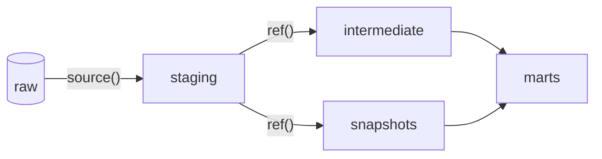

# Contributing

English | [Türkçe](tr/CONTRIBUTING.md)

This guide shows the standards of this dbt project. Follow them for every change.

## 1. Project structure

```text
models/
  _docs.md                  # shared doc blocks
  staging/                  # 1:1 with source, view
    _sources.yml
    _stg_berka.yml
    stg_berka__<entity>.sql
  intermediate/             # joins and derived columns, view
    _int_berka.yml
    int_<entity>_<verb>.sql
  marts/core/               # star schema: dim = table, fct = incremental
    _core__models.yml
    dim_*.sql, fct_*.sql, bridge_*.sql
snapshots/_snapshots.yml    # SCD2 (snp_*)
tests/<layer>/assert_*.sql  # singular tests
scripts/                    # raw load and CDC simulation
```

## 2. Layer rules



| Layer | Allowed | Not allowed |
|---|---|---|
| Staging | Rename, cast, simple code mapping (`case when`) | Join, aggregation, derived columns |
| Intermediate | Join, derived columns | Final star schema |
| Marts | Dimensions, facts, bridges | Raw tables (use `ref()` only) |

- Read raw tables only with `source()`. Read models only with `ref()`.
- Use the CTE pattern: `with source as (...), renamed as (...) select * from renamed`.

## 3. Naming

| Item | Rule | Example |
|---|---|---|
| Model prefix | Short prefix only for model layers | `stg_`, `int_`, `dim_`, `fct_`, `snp_` |
| Staging model | `stg_<source>__<entity>` (plural) | `stg_berka__accounts` |
| Intermediate model | `int_<entity>_<verb>` | `int_clients_enriched` |
| Singular test | `assert_<rule>` in full words | `assert_fact_row_counts_match_staging` |
| Column | Full words, `snake_case` | `transaction_date`, not `trx_dt` |

## 4. YAML

- Keep `description` and tests in the same YAML file as the model.
- Give every model and every column a `description`.
- Put shared column descriptions in `models/_docs.md`. Use `"{{ doc('name') }}"`.
- Generic tests: `data_tests:`. Unit tests: `unit_tests:`.
- Every model needs a primary key test (`unique` + `not_null`).

## 5. Add a new model

1. Create a branch: `git checkout -b feat/<short-name>`.
2. Write the SQL file in the correct layer folder.
3. Add `description` and tests to the layer YAML file.
4. Run `docker compose run --rm dbt dbt build --select <model>+`.
5. Run the full build (section 7).
6. Commit and open a pull request.

## 6. Commits

Use [Conventional Commits](https://www.conventionalcommits.org/):

| Type | Use |
|---|---|
| `feat:` | New model or feature |
| `fix:` | Bug fix |
| `test:` | New or changed test |
| `docs:` | Documentation only |
| `refactor:` | Code change, same result |
| `chore:` | Config, tooling |

Example: `feat: add fct_orders incremental model`

## 7. Before a pull request

```bash
docker compose run --rm dbt dbt parse
docker compose run --rm dbt dbt build
```

- `dbt build` must show no `ERROR` and no `FAIL`.
- Check new `WARN` results and explain them in the pull request.
- Use LF line endings (`.gitattributes` sets this).
