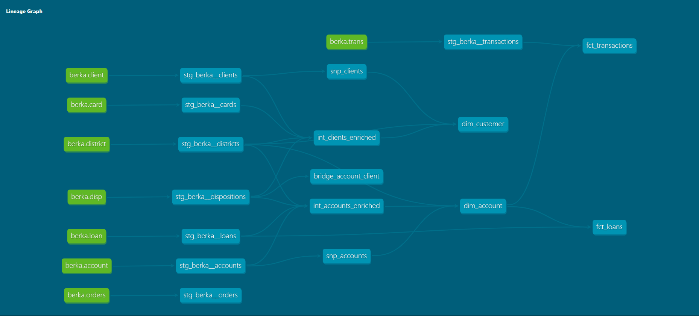
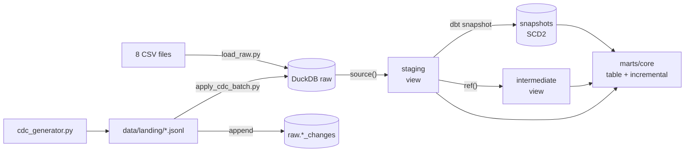
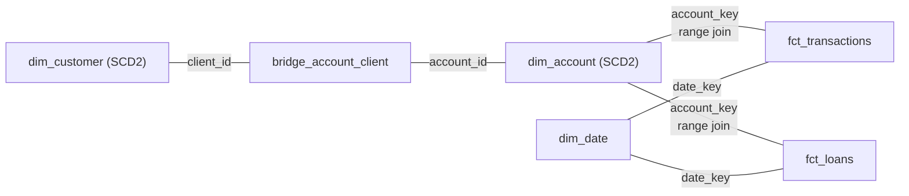
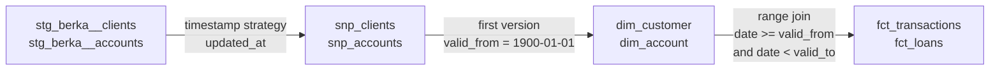
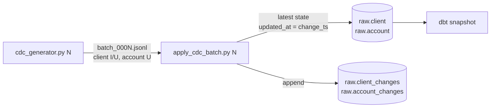

# Berka dbt Modeling

**English** | [Türkçe](tr/README.md)

A dbt project that models the Berka banking dataset into a **star schema** with **SCD Type 2** dimensions. Change batches (CDC) are simulated and captured with **dbt snapshots**. The project runs locally with **DuckDB** inside **Docker**.

Highlights:

- Layered dbt project: sources → staging → intermediate → marts (`marts/core`).
- Star schema: 2 SCD2 dimensions, a date dimension, a bridge table and 2 incremental fact tables.
- SCD2 with `dbt snapshot` (timestamp strategy) and a range join from facts to dimension versions.
- CDC simulation: Python scripts generate and apply change batches to the raw layer.
- 98 data tests + 1 unit test, source freshness, `store_failures`. `dbt build` → `PASS=117`.



## Dataset

The **Berka dataset** is real, anonymized data from a Czech bank (1993–1998). It was published for the **PKDD'99 Discovery Challenge**. It has 8 tables: accounts, clients, dispositions, cards, districts, loans, permanent orders and transactions (1,056,320 rows).

| | Link |
|---|---|
| Download (CSV) | [Kaggle – The Berka Dataset](https://www.kaggle.com/datasets/marceloventura/the-berka-dataset) |
| Original description | [PKDD'99 Discovery Challenge – Financial Data](https://sorry.vse.cz/~berka/challenge/pkdd1999/berka.htm) |

The data is not in this repository.

## Tech stack

| Component | Choice |
|---|---|
| Transformation | dbt Core 1.12 (`dbt-core==1.12.7`) |
| Database | DuckDB (`dbt-duckdb==1.11.1`), single file `berka.duckdb` |
| Package | `dbt_utils` 1.4.1 (surrogate keys, date spine, tests) |
| Runtime | Docker (`python:3.12-slim` + `git`), Docker Compose |
| Scripts | Python (raw load, CDC generator, CDC apply) |

## Architecture



## Layers

| Layer | Models | Materialization | Responsibility |
|---|---|---|---|
| Sources | 8 raw tables (`raw` schema) | – | All columns `VARCHAR`. PK tests and freshness (`_loaded_at`) |
| Staging | `stg_berka__*` (8) | `view` | 1:1 with source: rename, cast, decode Czech codes. No joins |
| Snapshots | `snp_clients`, `snp_accounts` | snapshot | SCD2 history (`main_snapshots` schema) |
| Intermediate | `int_clients_enriched`, `int_accounts_enriched` | `view` | Joins and derived columns (gender, birth date, age, owner, disponent count) |
| Marts | `dim_customer`, `dim_account`, `dim_date`, `bridge_account_client`, `fct_transactions`, `fct_loans` | `table` / `incremental` | Star schema |

## Star schema



| Model | Grain | Notes |
|---|---|---|
| `dim_customer` | 1 client version | Surrogate key = hash(`client_id`, `valid_from`). Type 2: district columns. Type 1: gender, age, card |
| `dim_account` | 1 account version | Surrogate key = hash(`account_id`, `valid_from`). Type 2: `frequency`, district columns |
| `dim_date` | 1 day (1993-01-01 – 1998-12-31) | Built with `dbt_utils.date_spine`. `date_key` = YYYYMMDD |
| `bridge_account_client` | 1 disposition | Many-to-many account ↔ client. Uses durable (natural) keys |
| `fct_transactions` | 1 transaction | Incremental (`delete+insert`). `signed_amount`: credit +, debit − |
| `fct_loans` | 1 loan | Incremental (`delete+insert`) |

`birth_number` (PII) stays in staging. Only derived columns go to marts.

## SCD Type 2 with dbt snapshot



- **Snapshot config:** `strategy: timestamp` on `updated_at`, `hard_deletes: new_record`, `dbt_valid_to_current = 9999-12-31`. The current version never has a `NULL` end date.
- **First version starts at 1900-01-01.** The initial load sets `updated_at = 1998-12-31`, so the first `dbt_valid_from` is 1998-12-31. Facts start in 1993. Without a fix, the range join finds no version for older facts. The dimension sets `valid_from = 1900-01-01` for the first version of each key (`min(dbt_valid_from) over (partition by key)`). The snapshot table does not change.
- **Range join:** a fact row joins the version where `date >= valid_from and date < valid_to`. The interval is half-open, so each date matches exactly one version. A `left join` plus a `not_null` test catches missing versions.
- **Bridge:** uses durable keys (`account_id`, `client_id`), so it links to all versions.

## CDC simulation



- `cdc_generator.py` reads raw data (read-only) and writes one batch file. The seed is `42 + batch_id`, so batches are reproducible.
- `apply_cdc_batch.py` sorts changes by `change_ts`, uses one transaction per table and skips keys that do not exist (logged).
- **Idempotent:** an insert is applied as delete + insert, and the change log first deletes rows of the same `batch_id`. Tested: applying batch 1 twice gives the same row counts and no new snapshot versions.
- Test cases: batch 2 updates the same client twice (U→U); batch 3 updates a client that does not exist.

Result after 3 batches: `dim_customer` 5,412 versions (5,375 current), `dim_account` 4,535 versions (4,500 current).

## Tests

| Layer | Tests |
|---|---|
| Source (8) | PK `unique` + `not_null`. Freshness on `_loaded_at` (warn 24h, error 48h) |
| Staging (8) | PK `unique` + `not_null`. `accepted_values` on decoded columns (`severity: warn`) |
| Intermediate (2) | Grain `unique` + `not_null`. Unit test for `birth_number` decoding (gender, birth date, age) |
| Snapshot (2) | `dbt_scd_id` unique, key + `dbt_valid_from` unique, `dbt_valid_from < dbt_valid_to` |
| Marts (6) | Keys, `relationships`, `unique_combination_of_columns`, `expression_is_true`, `accepted_range`. SCD2 checks on dimensions |
| Singular (4) | `assert_account_has_one_owner`, `assert_fact_row_counts_match_staging`, `assert_scd2_has_one_current_version`, `assert_scd2_versions_have_no_gaps` |

Total: 98 data tests + 1 unit test. Failed rows are stored in `main_dbt_test__audit` (`store_failures: true`).

## Quick start

Requirements: Docker and a bash shell (Git Bash on Windows).

1. Clone the repository.

   ```bash
   git clone https://github.com/samet-usta/berka-dbt-modeling.git
   cd berka-dbt-modeling
   ```

2. Download the CSV files from Kaggle. Put the 8 files in `data/raw/`: `account.csv`, `card.csv`, `client.csv`, `disp.csv`, `district.csv`, `loan.csv`, `order.csv`, `trans.csv`.

3. Build the image and install dbt packages.

   ```bash
   docker compose build
   docker compose run --rm dbt dbt deps
   docker compose run --rm dbt dbt debug
   ```

4. Load raw data and create staging views.

   ```bash
   docker compose run --rm dbt python scripts/load_raw.py
   docker compose run --rm dbt dbt run --select staging
   ```

5. Take the first snapshot. Then simulate 3 CDC batches.

   ```bash
   docker compose run --rm dbt dbt snapshot
   for N in 1 2 3; do
     docker compose run --rm dbt python scripts/cdc_generator.py $N
     docker compose run --rm dbt python scripts/apply_cdc_batch.py $N
     docker compose run --rm dbt dbt snapshot
   done
   ```

6. Build and test everything.

   ```bash
   docker compose run --rm dbt dbt build
   docker compose run --rm dbt dbt source freshness
   ```

   Expected: `PASS=117`.

7. Open the documentation at <http://localhost:8081>.

   ```bash
   docker compose run --rm dbt dbt docs generate
   docker compose run --rm --service-ports dbt dbt docs serve --host 0.0.0.0 --port 8080
   ```

`load_raw.py` resets the raw layer (including the change log). To start again, run the steps from step 4.

## Known limitations

- **Intermediate versions are not in the snapshot.** A snapshot stores the state at run time. If a key changes two times between two snapshot runs, only the last state becomes a version. Batch 2 shows this: clients 3274 and 6604 change two times, the change log has 2 rows, the snapshot has only the final state. Facts in the intermediate period link to the wrong version. The full history is kept in `raw.client_changes` and `raw.account_changes`. Possible solutions:
  - Run the snapshot after each change (higher frequency).
  - Build SCD2 from the change log: initial state `union all` changes, `valid_to = lead(change_ts) over (partition by key order by change_ts)`.
- **No batch control table.** `apply_cdc_batch.py` is idempotent for the same batch, but it does not record which batches are already processed. It does not stop a batch that runs out of order. A production pipeline keeps a batch control table.
- **Snapshot reads a staging view.** If staging logic changes a tracked column, the snapshot can open false versions.

## Possible extensions

- SCD2 for `district` and `card` attributes.
- SCD2 built from the change log (see Known limitations).
- `fct_orders` from `stg_berka__orders` (staging exists, no mart yet).
- CI with GitHub Actions: `dbt build` on each pull request.

## Project structure

```text
├── data/raw/            # CSV files (not in Git)
├── docs/images/         # README images
├── models/
│   ├── _docs.md         # shared doc blocks
│   ├── staging/         # _sources.yml, stg_berka__*
│   ├── intermediate/    # int_*
│   └── marts/core/      # dim_*, bridge_*, fct_*
├── snapshots/           # _snapshots.yml
├── tests/marts/         # singular tests
├── scripts/             # load_raw.py, cdc_generator.py, apply_cdc_batch.py
├── tr/                  # Turkish copies
├── dbt_project.yml
├── profiles.yml
├── packages.yml / package-lock.yml
├── Dockerfile
└── docker-compose.yml
```

## Contributing

See [CONTRIBUTING.md](CONTRIBUTING.md).
