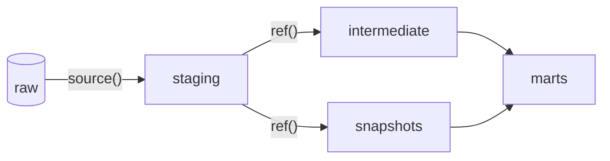

# Katkı Rehberi

[English](../CONTRIBUTING.md) | Türkçe

Bu rehber, bu dbt projesinin standartlarını gösterir. Her değişiklikte bu kurallara uy.

## 1. Proje yapısı

```text
models/
  _docs.md                  # ortak doc block'lar
  staging/                  # source ile 1:1, view
    _sources.yml
    _stg_berka.yml
    stg_berka__<entity>.sql
  intermediate/             # join ve türetilmiş kolonlar, view
    _int_berka.yml
    int_<entity>_<verb>.sql
  marts/core/               # star schema: dim = table, fct = incremental
    _core__models.yml
    dim_*.sql, fct_*.sql, bridge_*.sql
snapshots/_snapshots.yml    # SCD2 (snp_*)
tests/<katman>/assert_*.sql # singular test'ler
scripts/                    # raw yükleme ve CDC simülasyonu
```

## 2. Katman kuralları



| Katman | Serbest | Yasak |
|---|---|---|
| Staging | Rename, cast, basit kod çevirisi (`case when`) | Join, aggregation, türetilmiş kolon |
| Intermediate | Join, türetilmiş kolon | Son star schema |
| Marts | Dimension, fact, bridge | Raw tablo (sadece `ref()` kullan) |

- Raw tabloları sadece `source()` ile oku. Model'leri sadece `ref()` ile oku.
- CTE kalıbını kullan: `with source as (...), renamed as (...) select * from renamed`.

## 3. İsimlendirme

| Öğe | Kural | Örnek |
|---|---|---|
| Model öneki | Kısaltma sadece model katman öneklerinde | `stg_`, `int_`, `dim_`, `fct_`, `snp_` |
| Staging model | `stg_<source>__<entity>` (çoğul) | `stg_berka__accounts` |
| Intermediate model | `int_<entity>_<verb>` | `int_clients_enriched` |
| Singular test | `assert_<kural>`, tam kelime | `assert_fact_row_counts_match_staging` |
| Kolon | Tam kelime, `snake_case` | `transaction_date`, `trx_dt` değil |

## 4. YAML

- `description` ve test'leri model ile aynı YAML dosyasında tut.
- Her model ve her kolona `description` yaz.
- Ortak kolon açıklamalarını `models/_docs.md` içine koy. `"{{ doc('ad') }}"` kullan.
- Generic test: `data_tests:`. Unit test: `unit_tests:`.
- Her model'de primary key test'i olmalı (`unique` + `not_null`).

## 5. Yeni model ekleme

1. Branch aç: `git checkout -b feat/<kisa-ad>`.
2. SQL dosyasını doğru katman klasörüne yaz.
3. Katman YAML dosyasına `description` ve test ekle.
4. `docker compose run --rm dbt dbt build --select <model>+` çalıştır.
5. Tam build'i çalıştır (bölüm 7).
6. Commit at ve pull request aç.

## 6. Commit

[Conventional Commits](https://www.conventionalcommits.org/) kullan:

| Tip | Kullanım |
|---|---|
| `feat:` | Yeni model veya özellik |
| `fix:` | Hata düzeltme |
| `test:` | Yeni veya değişen test |
| `docs:` | Sadece doküman |
| `refactor:` | Kod değişir, sonuç aynı |
| `chore:` | Config, araçlar |

Örnek: `feat: add fct_orders incremental model`

## 7. Pull request öncesi

```bash
docker compose run --rm dbt dbt parse
docker compose run --rm dbt dbt build
```

- `dbt build` sonucunda `ERROR` ve `FAIL` olmamalı.
- Yeni `WARN` sonuçlarını kontrol et ve pull request'te açıkla.
- LF satır sonu kullan (`.gitattributes` bunu ayarlar).
