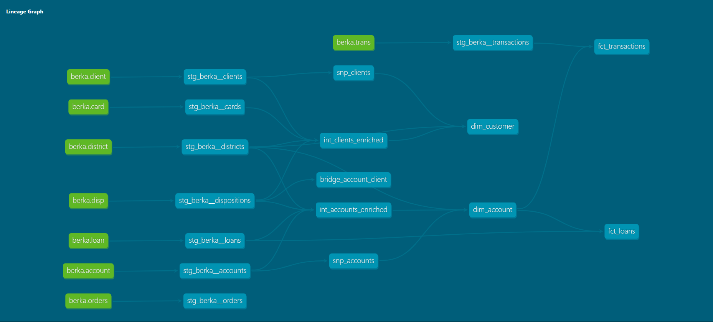
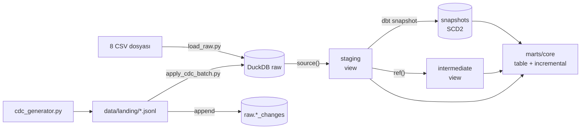
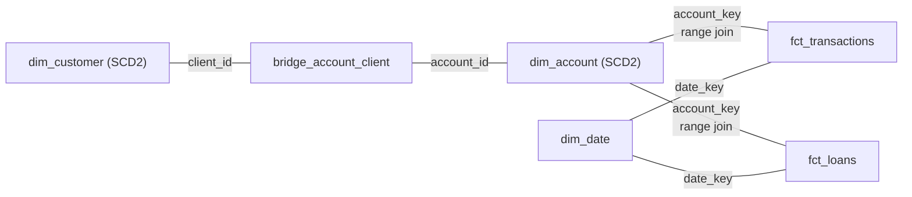
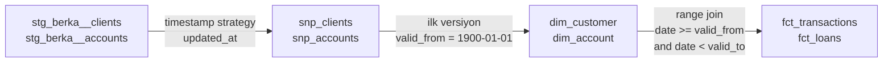
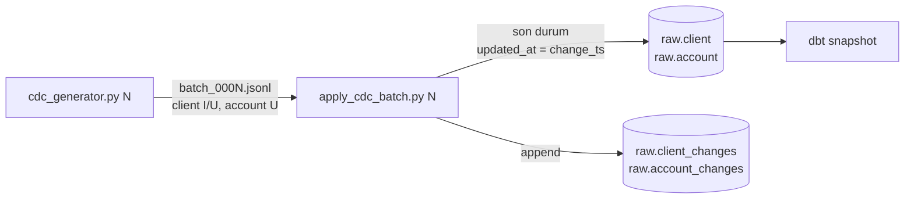

# Berka dbt Modeling

[English](../README.md) | **Türkçe**

Berka bankacılık verisini **star schema** ve **SCD Type 2** dimension'larla modelleyen bir dbt projesi. Değişiklik batch'leri (CDC) simüle edilir ve **dbt snapshot** ile yakalanır. Proje lokal olarak **Docker** içinde **DuckDB** ile çalışır.

Öne çıkanlar:

- Katmanlı dbt projesi: sources → staging → intermediate → marts (`marts/core`).
- Star schema: 2 SCD2 dimension, bir date dimension, bir bridge tablo ve 2 incremental fact tablo.
- `dbt snapshot` ile SCD2 (timestamp strategy) ve fact'ten dimension versiyonuna range join.
- CDC simülasyonu: Python script'leri değişiklik batch'lerini üretir ve raw katmana uygular.
- 98 data test + 1 unit test, source freshness, `store_failures`. `dbt build` → `PASS=117`.



## Dataset

**Berka dataset**, bir Çek bankasının gerçek ve anonimleştirilmiş verisidir (1993–1998). **PKDD'99 Discovery Challenge** için yayınlandı. 8 tablo içerir: account, client, disposition, card, district, loan, permanent order ve transaction (1.056.320 satır).

| | Link |
|---|---|
| İndirme (CSV) | [Kaggle – The Berka Dataset](https://www.kaggle.com/datasets/marceloventura/the-berka-dataset) |
| Orijinal açıklama | [PKDD'99 Discovery Challenge – Financial Data](https://sorry.vse.cz/~berka/challenge/pkdd1999/berka.htm) |

Veri bu repository'de yoktur.

## Teknik yığın

| Bileşen | Seçim |
|---|---|
| Transformation | dbt Core 1.12 (`dbt-core==1.12.7`) |
| Database | DuckDB (`dbt-duckdb==1.11.1`), tek dosya `berka.duckdb` |
| Package | `dbt_utils` 1.4.1 (surrogate key, date spine, test'ler) |
| Çalışma ortamı | Docker (`python:3.12-slim` + `git`), Docker Compose |
| Script'ler | Python (raw yükleme, CDC generator, CDC apply) |

## Mimari



## Katmanlar

| Katman | Model'ler | Materialization | Sorumluluk |
|---|---|---|---|
| Sources | 8 raw tablo (`raw` schema) | – | Tüm kolonlar `VARCHAR`. PK test'leri ve freshness (`_loaded_at`) |
| Staging | `stg_berka__*` (8) | `view` | Source ile 1:1: rename, cast, Çekçe kod çevirisi. Join yok |
| Snapshots | `snp_clients`, `snp_accounts` | snapshot | SCD2 geçmişi (`main_snapshots` schema) |
| Intermediate | `int_clients_enriched`, `int_accounts_enriched` | `view` | Join ve türetilen kolonlar (gender, doğum tarihi, yaş, owner, disponent sayısı) |
| Marts | `dim_customer`, `dim_account`, `dim_date`, `bridge_account_client`, `fct_transactions`, `fct_loans` | `table` / `incremental` | Star schema |

## Star schema



| Model | Grain | Not |
|---|---|---|
| `dim_customer` | 1 client versiyonu | Surrogate key = hash(`client_id`, `valid_from`). Type 2: district kolonları. Type 1: gender, yaş, kart |
| `dim_account` | 1 account versiyonu | Surrogate key = hash(`account_id`, `valid_from`). Type 2: `frequency`, district kolonları |
| `dim_date` | 1 gün (1993-01-01 – 1998-12-31) | `dbt_utils.date_spine` ile kurulur. `date_key` = YYYYMMDD |
| `bridge_account_client` | 1 disposition | Account ↔ client many-to-many. Durable (natural) key kullanır |
| `fct_transactions` | 1 transaction | Incremental (`delete+insert`). `signed_amount`: credit +, debit − |
| `fct_loans` | 1 loan | Incremental (`delete+insert`) |

`birth_number` (PII) staging'de kalır. Mart'lara sadece türetilen kolonlar girer.

## dbt snapshot ile SCD Type 2



- **Snapshot config:** `updated_at` üzerinde `strategy: timestamp`, `hard_deletes: new_record`, `dbt_valid_to_current = 9999-12-31`. Current versiyonun bitiş tarihi hiç `NULL` olmaz.
- **İlk versiyon 1900-01-01'de başlar.** İlk yükleme `updated_at = 1998-12-31` yazar, bu yüzden ilk `dbt_valid_from` 1998-12-31 olur. Fact'ler 1993'te başlar. Düzeltme olmazsa range join eski fact'ler için versiyon bulamaz. Dimension, her key'in ilk versiyonunda `valid_from = 1900-01-01` yazar (`min(dbt_valid_from) over (partition by key)`). Snapshot tablosu değişmez.
- **Range join:** fact satırı `date >= valid_from and date < valid_to` koşulunu sağlayan versiyona bağlanır. Aralık yarı açıktır, bu yüzden her tarih tam 1 versiyona düşer. `left join` ve `not_null` test'i eksik versiyonu yakalar.
- **Bridge:** durable key (`account_id`, `client_id`) kullanır, bu yüzden tüm versiyonlara bağlanır.

## CDC simülasyonu



- `cdc_generator.py` raw veriyi okur (read-only) ve tek bir batch dosyası yazar. Seed `42 + batch_id` olduğu için batch'ler tekrar üretilebilir.
- `apply_cdc_batch.py` değişiklikleri `change_ts` ile sıralar, tablo başına 1 transaction kullanır ve olmayan key'leri atlar (log'a yazar).
- **Idempotent:** insert, delete + insert olarak uygulanır. Change log önce aynı `batch_id` satırlarını siler. Test edildi: batch 1 iki kez uygulandı, satır sayıları aynı kaldı, snapshot yeni versiyon açmadı.
- Test senaryoları: batch 2 aynı client'ı iki kez günceller (U→U); batch 3 olmayan bir client'ı günceller.

3 batch sonrası sonuç: `dim_customer` 5.412 versiyon (5.375 current), `dim_account` 4.535 versiyon (4.500 current).

## Test'ler

| Katman | Test'ler |
|---|---|
| Source (8) | PK `unique` + `not_null`. `_loaded_at` üzerinde freshness (warn 24h, error 48h) |
| Staging (8) | PK `unique` + `not_null`. Kod çevirisi kolonlarında `accepted_values` (`severity: warn`) |
| Intermediate (2) | Grain `unique` + `not_null`. `birth_number` çözümü için unit test (gender, doğum tarihi, yaş) |
| Snapshot (2) | `dbt_scd_id` unique, key + `dbt_valid_from` unique, `dbt_valid_from < dbt_valid_to` |
| Marts (6) | Key'ler, `relationships`, `unique_combination_of_columns`, `expression_is_true`, `accepted_range`. Dimension'larda SCD2 kontrolleri |
| Singular (4) | `assert_account_has_one_owner`, `assert_fact_row_counts_match_staging`, `assert_scd2_has_one_current_version`, `assert_scd2_versions_have_no_gaps` |

Toplam: 98 data test + 1 unit test. Hatalı satırlar `main_dbt_test__audit` içinde saklanır (`store_failures: true`).

## Quick start

Gereksinimler: Docker ve bir bash shell (Windows'ta Git Bash).

1. Repository'yi clone et.

   ```bash
   git clone https://github.com/samet-usta/berka-dbt-modeling.git
   cd berka-dbt-modeling
   ```

2. CSV dosyalarını Kaggle'dan indir. 8 dosyayı `data/raw/` içine koy: `account.csv`, `card.csv`, `client.csv`, `disp.csv`, `district.csv`, `loan.csv`, `order.csv`, `trans.csv`.

3. Image'ı build et ve dbt package'larını kur.

   ```bash
   docker compose build
   docker compose run --rm dbt dbt deps
   docker compose run --rm dbt dbt debug
   ```

4. Raw veriyi yükle ve staging view'larını kur.

   ```bash
   docker compose run --rm dbt python scripts/load_raw.py
   docker compose run --rm dbt dbt run --select staging
   ```

5. İlk snapshot'ı al. Sonra 3 CDC batch'ini simüle et.

   ```bash
   docker compose run --rm dbt dbt snapshot
   for N in 1 2 3; do
     docker compose run --rm dbt python scripts/cdc_generator.py $N
     docker compose run --rm dbt python scripts/apply_cdc_batch.py $N
     docker compose run --rm dbt dbt snapshot
   done
   ```

6. Tüm model'leri kur ve test et.

   ```bash
   docker compose run --rm dbt dbt build
   docker compose run --rm dbt dbt source freshness
   ```

   Beklenen: `PASS=117`.

7. Dokümantasyonu <http://localhost:8081> adresinde aç.

   ```bash
   docker compose run --rm dbt dbt docs generate
   docker compose run --rm --service-ports dbt dbt docs serve --host 0.0.0.0 --port 8080
   ```

`load_raw.py` raw katmanı sıfırlar (change log dahil). Baştan başlamak için 4. adımdan devam et.

## Known limitations

- **Ara versiyonlar snapshot'ta yok.** Snapshot, çalıştığı andaki durumu saklar. Bir key iki snapshot run'ı arasında iki kez değişirse sadece son durum versiyon olur. Batch 2 bunu gösterir: client 3274 ve 6604 iki kez değişir, change log'da 2 satır var, snapshot'ta sadece son durum var. Ara dönemdeki fact'ler yanlış versiyona bağlanır. Tam geçmiş `raw.client_changes` ve `raw.account_changes` içinde durur. Olası çözümler:
  - Snapshot'ı her değişiklikten sonra çalıştırmak (daha sık).
  - SCD2'yi change log'dan kurmak: ilk durum `union all` değişiklikler, `valid_to = lead(change_ts) over (partition by key order by change_ts)`.
- **Batch control tablosu yok.** `apply_cdc_batch.py` aynı batch için idempotent'tir, ama hangi batch'lerin işlendiğini kaydetmez. Sırası bozuk gelen bir batch'i durdurmaz. Production pipeline bir batch control tablosu tutar.
- **Snapshot bir staging view'ı okur.** Staging mantığı izlenen bir kolonu değiştirirse snapshot sahte versiyon açabilir.

## Possible extensions

- `district` ve `card` kolonları için SCD2.
- Change log'dan kurulan SCD2 (bkz. Known limitations).
- `stg_berka__orders` üzerinden `fct_orders` (staging var, mart henüz yok).
- GitHub Actions ile CI: her pull request'te `dbt build`.

## Proje yapısı

```text
├── data/raw/            # CSV dosyaları (Git'te yok)
├── docs/images/         # README görselleri
├── models/
│   ├── _docs.md         # ortak doc block'lar
│   ├── staging/         # _sources.yml, stg_berka__*
│   ├── intermediate/    # int_*
│   └── marts/core/      # dim_*, bridge_*, fct_*
├── snapshots/           # _snapshots.yml
├── tests/marts/         # singular test'ler
├── scripts/             # load_raw.py, cdc_generator.py, apply_cdc_batch.py
├── tr/                  # Türkçe kopyalar
├── dbt_project.yml
├── profiles.yml
├── packages.yml / package-lock.yml
├── Dockerfile
└── docker-compose.yml
```

## Katkı

Bkz. [CONTRIBUTING.md](CONTRIBUTING.md).
